# Built-in local Whisper transcription

This note describes the change that makes Whisper the default speech-to-text (Hearing) provider.
Whisper runs on the user's device. Audio does not leave the device.

## What the user gets

- A new transcription provider: **Whisper (Local)** (provider id `whisper-local`).
- New installs use it by default with **Whisper Small**. The user chose Small because it is better
  than Base with other languages and accents, and much smaller than Large v3 Turbo.
- The model downloads one time, the first time Hearing transcribes speech or when the user clicks
  **Download model** on the provider settings page. After that, Whisper works offline. The browser
  cache stores the model files.
- Three models can be selected in **Settings > Hearing** or on the provider page:

| Model | ID | Use it when |
| --- | --- | --- |
| Whisper Base | `whisper-base` | The device is slow or has no GPU. It is the smallest and fastest model. |
| Whisper Small | `whisper-small` | Default. Good accuracy in many languages. |
| Whisper Large v3 Turbo | `whisper-large-v3-turbo` | The device has a GPU that supports WebGPU and accuracy matters most. It is the largest download. |

## How it works

```mermaid
flowchart LR
  Mic["Microphone"] --> VAD["VAD: one spoken phrase"] --> Rec["Recording (Blob)"]
  Rec --> Hearing["Hearing store: generateTranscription()"]
  Hearing --> Fetch["whisper-local fetch()"]
  Fetch --> Decode["OfflineAudioContext: mono, 16 kHz"]
  Decode --> Adapter["Whisper adapter: load model, transcribe"]
  Adapter --> Worker["Web worker: transformers.js WhisperForConditionalGeneration"]
  Worker --> Text["{ text }"] --> Chat["Chat input / send"]
```

1. **Provider** (`packages/stage-ui/src/libs/providers/providers/whisper-local/index.ts`).
   Like the local Kokoro text-to-speech provider, it pretends to be an OpenAI-compatible API.
   `transcription(model)` returns `{ baseURL: 'http://whisper-local/v1/', model, fetch }`. The custom
   `fetch` answers the request on the device:
   - It reads the multipart body that `@xsai/generate-transcription` sends (file, model, language).
   - It decodes the audio to mono 16 kHz samples with `OfflineAudioContext`.
   - It splits audio longer than 30 seconds into windows that end in pauses (see Known limits).
   - It loads the selected model (a no-op if it is already loaded) and transcribes each window.
   - It returns `{ text }` as JSON.
   - It sends a language hint only when Whisper supports that language. Otherwise Whisper detects
     the language.
2. **Adapter** (`packages/stage-ui/src/libs/inference/adapters/whisper.ts`). One shared adapter
   (`getWhisperAdapter()`) owns the worker. It loads one model at a time, switches models when asked,
   and reports download progress for each model to the inference status store. Load and
   transcription timeouts reset while the worker reports progress, so a slow download does not fail.
3. **Worker** (`packages/stage-ui/src/libs/workers/worker.ts`). It runs transformers.js. It uses
   WebGPU when available and WebAssembly otherwise. It reads the number of mel bins and the decoder
   length limit from the model's config, so Base, Small, and Large v3 Turbo all work.
4. **Defaults** (`packages/stage-ui/src/stores/modules/hearing.ts`, `default.ts`).
   - New installs: Hearing uses Whisper (Local) with Whisper Small.
   - Login: an empty Hearing selection gets Whisper (Local). The official cloud provider is still
     set up, so a logged-in user can choose it.
   - Logout: if Hearing used the official cloud provider, it falls back to Whisper (Local).
5. **Settings page** (`packages/stage-pages/src/pages/settings/providers/transcription/whisper-local.vue`).
   It explains the models, lets the user choose the model that Hearing uses, downloads the model
   with a progress bar, and includes the transcription playground.

## Before this change

The repository already had most of the engine: a Whisper web worker and adapter that loaded only
`whisper-large-v3-turbo` (about 800 MB), with no provider that used them. The existing
"Browser (Local)" and "App (Local)" transcription providers are unfinished placeholders. This change
leaves them as they are.

## Known limits

- **Not tested with real models in the cloud session.** `huggingface.co` is blocked there. Test on a
  real machine: open **Settings > Providers > Whisper (Local)**, click **Download model**, then use
  the playground or talk to the character.
- **Existing installs are not migrated.** If an install already saved an empty Hearing provider, it
  stays empty until the user picks a provider or logs in. AGENTS.md does not allow silent
  compatibility code.
- **Long recordings are split.** Whisper reads at most 30 seconds at a time. A longer recording is
  transcribed in windows of up to 30 seconds. Each window ends at the quietest 100 ms in its last
  5 seconds, so the cut normally falls in a pause. A window that is more than 50 dB quieter than the
  loudest part of the recording is skipped, because Whisper writes made-up words for silence. The
  windows do not overlap: if there is no pause near the limit, a word at the cut can be garbled.
  Without a language hint, the language is detected again for each window.
- **First use is slow.** The first transcription downloads the model and compiles it. Later
  transcriptions are fast, especially with WebGPU.
- **The ONNX Runtime engine comes from a CDN.** transformers.js 3.8.1 loads its WebAssembly engine
  (`ort-wasm-simd-threaded.jsep.*`, about 21 MB) from `cdn.jsdelivr.net` unless the app sets
  `env.backends.onnx.wasm.wasmPaths` (`src/backends/onnx.js`). AIRI does not set it, so the first use
  also needs jsDelivr. The local Kokoro voice has the same limit. Fix options: add `onnxruntime-web` as a
  direct dependency, or copy the two files from `@huggingface/transformers/dist` at build time.
- **Confidence filter.** The Hearing confidence filter needs confidence scores for each segment.
  Whisper (Local) does not return them, so the filter has no effect and Hearing logs a warning.

## How it was tested

`huggingface.co` and `cdn.jsdelivr.net` are blocked in the cloud session. A temporary browser harness ran the
real code in Chromium and answered those requests with local files:

- Model: Xenova Whisper Tiny (multilingual, 80 mel bins, same vocabulary as Base and Small) from the
  `sts-whisper-tiny` npm package, served under the `onnx-community/whisper-small` and `whisper-base` names.
- Engine: the identical `ort-wasm-simd-threaded.jsep.*` files from the installed transformers.js package.
- Audio: `packages/testing-audio` fixtures, plus German and Spanish clips made with eSpeak NG.
- Device: WebAssembly (no GPU in the headless browser).

| Test | Result |
| --- | --- |
| English, English hint, first use (download, load, warm-up, transcribe) | "microphone warm up. Hello, Eric, please say hello." in about 15 s |
| English again, model loaded | Same text in about 3.5 s |
| English, no hint | Correct; "Microphone warm up." appears twice |
| German / Spanish with a hint | "Guten Morgen! Heute ist das mit der Mere schön und ich gerne den Park." / "Muy bien, hoy voy a cambiar el parque." |
| Switch Small to Base | Model reloaded, correct text |
| 36 s recording with speech at 29–33 s | Two windows (28.95 s and 7.16 s); the second utterance is transcribed. A single 30 s call kept only "My microphone warm up." |

Without a hint, the German and Spanish clips came out wrong ("Thank you for watching!", "(sad)"). An independent
check with plain transformers.js showed that Tiny itself ranks this robotic German as English (48.6 %) and the
Spanish as Latin (31 %), and the detection step picked exactly those languages (`<|la|>` in the token IDs). So
the detection code works; Tiny on synthetic speech is not reliable. Hearing normally sends the interface
language as a hint. Accuracy of the real Small and Large v3 Turbo models and WebGPU speed still need a test on
a real machine.
