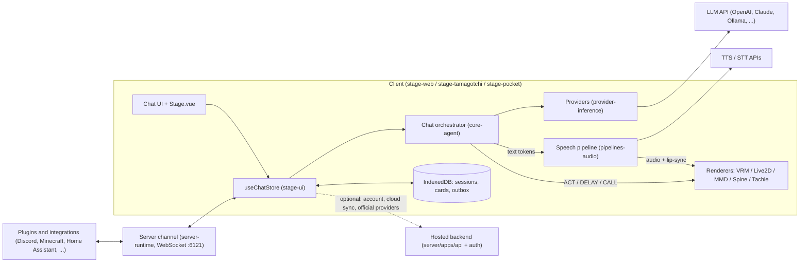

# How AIRI works

This note explains how Project AIRI works inside. It is based on reading the source code at
commit `1b019c3` (version `0.12.0-beta.5`). File paths are relative to the repository root.

See also: [`2026-10-19-airi-assessment.md`](./2026-10-19-airi-assessment.md) for features,
benefits, limitations, and proposed improvements. See [`../graph/`](../graph/README.md) for
interactive code maps made with Graphify.

## 1. The short version

AIRI is a virtual character that you can talk to. One turn works like this:

1. You type or speak. Speech becomes text through a transcription (STT) provider.
2. The chat orchestrator builds a prompt from the character card, the chat history, and live context.
3. A large language model (LLM) streams a reply back.
4. The reply contains hidden control tokens such as `<|ACT {"emotion":"happy"}|>` and `<|DELAY 1|>`.
   A parser takes these tokens out of the text.
5. The plain text goes to a text-to-speech (TTS) provider. The audio plays, and the character's mouth
   moves with it (lip-sync).
6. The control tokens change the character's expression and motion, pause playback, or call plugins.

Everything runs in the client (browser, Electron, or mobile app). The hosted backend is optional.

## 2. System map

## 3. Where things live

| Area | Location | Role |
| --- | --- | --- |
| Web app | `apps/stage-web` | Vue 3 single-page app. |
| Desktop app | `apps/stage-tamagotchi` | Electron app with about 15 windows (main stage, chat, settings, caption, widgets, spotlight, and others). |
| Mobile app | `apps/stage-pocket` | Capacitor wrapper for iOS and Android. |
| Shared business logic | `packages/stage-ui` | Pinia stores, composables, and components that all three apps use. This is the largest package. |
| Agent runtime | `packages/core-agent` | Send queue, prompt building, LLM streaming, tool rounds, hooks, and control-token parsing. |
| Model providers | `packages/provider-inference` | Definitions for about 45 cloud providers and 7 local providers. |
| Audio | `packages/pipelines-audio`, `packages/audio`, `packages/model-driver-lipsync` | Text segmentation, TTS scheduling, playback, control-token signals, and lip-sync. |
| Renderers | `packages/stage-ui-three` (VRM), `stage-ui-live2d`, `stage-ui-mmd`, `stage-ui-spine`, `stage-ui-tachie` | Draw and animate the character. |
| Plugin hub | `packages/server-runtime`, `server-sdk`, `server-shared`, `plugin-protocol`, `plugin-sdk` | WebSocket hub and SDK that plugins and services use to connect. |
| Plugins | `plugins/`, `integrations/`, `services/computer-use-mcp` | Bilibili, Home Assistant, chess, Claude Code, Discord, Telegram, Minecraft, and others. |
| Hosted backend | `server/apps/api`, `server/apps/auth` | Hono API: accounts, characters, cloud chat sync, official LLM/TTS proxy, Flux credits, and Stripe. |

## 4. One chat turn in detail

### 4.1 Entry: `useChatStore`

`packages/stage-ui/src/stores/chat.ts` creates the orchestrator with
`createChatOrchestratorRuntime(...)` and connects it to the Pinia stores. It passes:

- a session port (`chat/session-store.ts`) that reads and appends messages,
- an LLM port (`ai/chat-llm/llm.ts`) that streams from the selected provider,
- the active model and provider from `consciousness` (the store for the selected chat model),
- runtime context providers (the emotion prompt, user account, and Minecraft state),
- the toolset prompt supplement (for example, the web-search safety prompt).

In Electron, many windows can show the chat. `pinia-plugin-synced` chooses one **leader** window.
Only the leader runs a send. Other windows send a serializable `ChatSendPayload` to the leader.

### 4.2 Queue: one send at a time

`packages/core-agent/src/runtime/chat-orchestrator-runtime.ts`:

- `ingest()` puts the message in `sendQueue`. The queue runs one send at a time.
- Each queued send records the session **generation** number. If you reset or delete the session,
  the generation changes. The runtime then drops the stale send (`isStaleGeneration()`).
- Each send gets an `AbortController`, so you can cancel it.

### 4.3 Building the prompt (`performSend` → `buildContext`)

The prompt has these parts, in this order:

1. **System message.** The session store makes it from the active character card
   (`resolveSystemPrompt` in `stores/modules/airi-card.ts`). It joins `systemPrompt`,
   `description`, `personality`, `scenario`, and an optional artistry instruction.
2. **Toolset supplement.** This is added to the system message (`getSystemPromptSupplement`).
3. **Full session history.** Each user message gets a `[HH:MM]` time prefix. If the user replied to
   a message, it also gets a `[Replying to: ...]` prefix of up to 480 characters.
   Assistant messages replay their stored `generationTranscript`, so tool calls replay exactly.
4. **Runtime context.** This is added to the **last user turn** as a `runtime-context` segment.
   It includes the emotion and control-token instructions from
   `packages/i18n/src/locales/en/base.yaml` (`base.prompt.emotion`, `suffix`, `emoji`), plus context
   that plugins sent with `context:update`.

The default AIRI persona is in `base.prompt.prefix` in the same YAML file.

### 4.4 Streaming the reply

`deps.llm.stream(...)` calls `streamFrom` in `core-agent/src/runtime/llm-service.ts`. That function
chooses one of two adapters:

- the **Chat Completions** adapter (`messages/chat-completions.ts`), for most providers, or
- the **Responses API** adapter (`runtime/responses.ts`), which runs local tools for at most 10 steps
  and supports provider web search with citations.

Stream events go to the runtime:

| Event | What happens |
| --- | --- |
| `text-delta` | Goes to the control-token parser (see 4.5). |
| `reasoning-delta` | Collected as "reasoning". It is shown in the UI but never spoken. |
| `tool-call`, `tool-result`, `tool-error` | Added to the message as slices, so the UI can show them. |
| `search`, `citations` | Stored on the message for display. |
| `error` | Ends the turn with an error. |

### 4.5 Control tokens: how the character "acts"

`runtime/llm-marker-parser.ts` splits the text stream into two kinds of parts:

- **literal** text, and
- **special** tokens of the form `<|NAME payload|>`.

Then `runtime/response-categoriser.ts` removes any complete XML-like tag, such as `<think>...</think>`,
from the spoken text. It treats **every** tag as reasoning.

Special tokens go to `pipelines-audio/src/llm-streaming-control`. It knows three tokens:

| Token | Example | Effect |
| --- | --- | --- |
| `ACT` | `<\|ACT {"emotion":{"name":"happy","intensity":0.8},"motion":"wave"}\|>` | Sets the expression (VRM), the motion (Live2D), or the emotion (MMD, Spine, Tachie). There are 9 emotions: happy, sad, angry, think, surprised, awkward, question, curious, and neutral. |
| `DELAY` | `<\|DELAY 1\|>` | Pauses stage playback for N seconds. |
| `CALL` | `<\|CALL ["chess.play", {...}]\|>` | Sends a named call to a plugin. The stage does not read the payload. |

`Stage.vue` (`packages/stage-ui/src/components/scenes/Stage.vue`) connects these signals to the renderer:
`ACT` emotions go into `emotionsQueue`. That queue sets VRM expressions or Live2D motion groups.

### 4.6 Speech output and lip-sync

`Stage.vue` registers chat hooks:

| Hook | Action |
| --- | --- |
| `onBeforeMessageComposed` | Stops old audio and opens a new TTS session (`libs/speech/tts-session.ts`). |
| `onBeforeSend` | Plays the "thinking" motion. |
| `onTokenLiteral` | Sends text to the TTS session. |
| `onTokenSpecial` | Sends the token to the TTS session, so the emotion changes **at the same time** as the audio. If speech is muted, the token runs at once. |
| `onStreamEnd`, `onAssistantResponseEnd` | Ends input to the TTS session, then closes it. |

There are two TTS paths:

1. **Segmenter path** (most providers). `pipelines-audio` splits text into sentence-like segments.
   It sends up to 4 TTS requests at the same time, then plays the audio in order.
2. **Streaming path** (the official streaming provider). Raw tokens go over a two-way WebSocket, and
   the server splits the sentences.

During playback, an `AnalyserNode` and wLipSync (`model-driver-lipsync`) turn the audio into mouth
shapes. Captions go to the caption window through a `BroadcastChannel` named `airi-caption-overlay`.

### 4.7 After the turn

The assistant message is appended to the session. Then these hooks run in order:
`streamEnd`, `assistantResponseEnd`, `afterSend`, `assistantMessage`, and `chatTurnComplete`.
After each awaited hook, the runtime checks again whether the send was aborted or became stale.
Analytics callbacks record time to first token, latency, and token use.

## 5. Voice input (hearing)

`packages/stage-ui/src/stores/modules/hearing.ts`:

- The microphone audio goes to an AudioWorklet (`workers/vad/process.worklet`) for
  **voice activity detection (VAD)**, which finds when you start and stop speaking.
- The speech is converted to PCM16 and sent to a transcription provider. Supported providers include
  OpenAI-compatible Whisper, the browser Web Speech API, Apple Speech (macOS desktop), Aliyun NLS,
  and the official AIRI provider.
- The transcript becomes an `input:voice` or `input:text:voice` send. Voice turns are tagged so
  analytics can tell them apart from text turns.

## 6. Plugins and the server channel

`packages/server-runtime` is a WebSocket hub (H3 and CrossWS). By default it listens on
`127.0.0.1:6121`. The desktop app starts it in the main process (`services/airi/channel-server`).

- Plugins connect with `@proj-airi/server-sdk` and authenticate. Authentication is optional: it is
  only checked when `AUTHENTICATION_TOKEN` is set.
- Plugins **announce modules**, declare permissions, and receive configuration through a
  validate → plan → commit flow (`plugin-protocol/src/types/events.ts`).
- Plugins can:
  - send user input (`input:text`, `input:voice`),
  - push live context into the next prompt (`context:update`),
  - receive the character's output (`output:gen-ai:chat:message` and `output:gen-ai:chat:complete`),
  - send "Spark" notifications and commands (`spark:notify`, `spark:command`). Spark lets a plugin
    ask the agent to react to an event without a user message.
- The hub routes events by destination and consumer priority, and checks plugin health with
  heartbeats.
- MCP servers can also run over stdio from the desktop main process (`services/airi/mcp-servers`).
  Their tools are given to the LLM (`stores/mcp-tool-bridge.ts`).

## 7. Desktop app (Electron)

`apps/stage-tamagotchi/src/main/index.ts` connects every service with **injeca** dependency injection:

- configs, i18n, the auto-updater, and global shortcuts,
- the server channel, a built-in HTTP server, the MCP stdio manager, and the plugin (extension) host,
- an optional Godot 3D stage (`engines/stage-tamagotchi-godot`),
- windows: main, chat, settings, onboarding, notice, about, caption, widgets, spotlight, editor,
  beat-sync (a hidden window for Web Audio), devtools, and a desktop overlay (enabled with
  `AIRI_DESKTOP_OVERLAY=1`).

Renderer and main process talk through **Eventa** contracts (`apps/stage-tamagotchi/src/shared`).
On shutdown, the app runs the before-quit hooks and `injeca.stop()` at the same time, then flushes the
file logger.

## 8. Data storage

- **Local.** `packages/stage-ui/src/database/storage.ts` uses `unstorage`, backed by IndexedDB
  (`airi-local`). Chat sessions are stored there (`database/repos/chat-sessions.repo.ts`).
  Character cards and settings are stored in `localStorage`.
- **Cloud sync (optional).** Changes are queued in an IndexedDB outbox (`airi-sync-queue`) and
  uploaded to the backend. Only the **text** of messages is synced. Images and native provider data
  stay on the device.

## 9. Hosted backend (optional)

`server/apps/api` is a Hono app with Drizzle and PostgreSQL. Its domains are:

- characters and chats (cloud sync),
- providers, the provider catalog, and the LLM router (the official AIRI provider),
- OpenAI-compatible speech and voice packs,
- **Flux** credits, billing, and Stripe payments,
- request logs, LLM tracing, product events (OpenPanel), and user deletion.

`server/apps/auth` is a separate Better Auth and OIDC service. Run the full stack locally with
`pnpm dev:backend` (Docker Compose).

## 10. Character cards

Characters use **AIRI cards**. An AIRI card is a Character Card V3 (CCv3) with an
`extensions.airi` block (`stores/modules/airi-card.ts`). The block holds per-character module
settings: the chat model, voice, display model, and artistry. You can import standard CCv3 cards.
The fields that depend on position, such as example messages and the first message, are not used in
the prompt yet.
